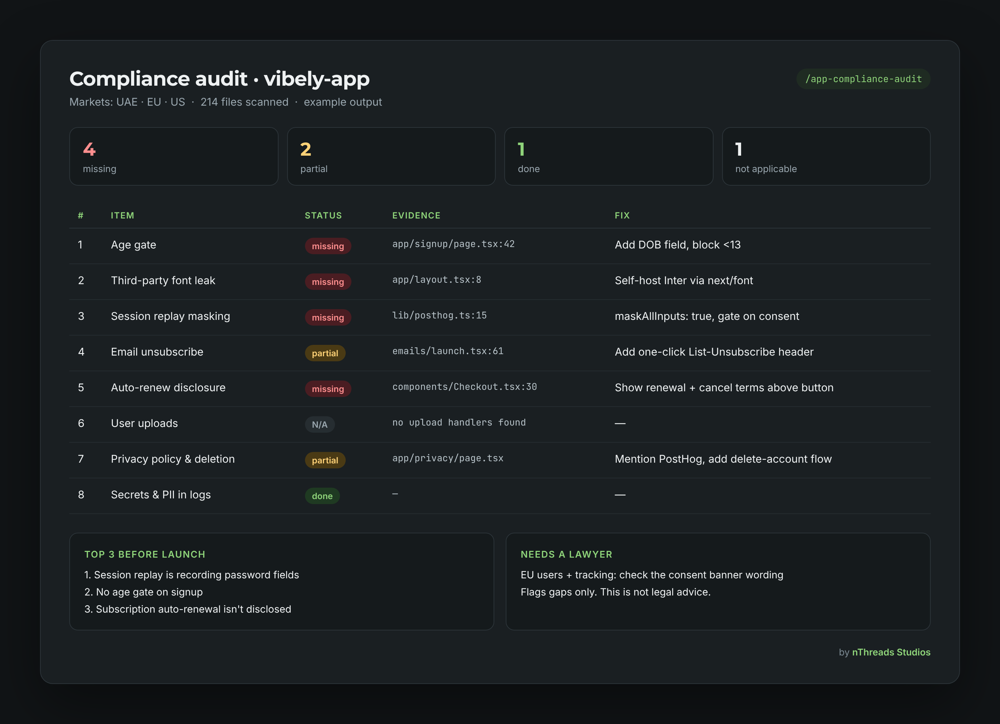

# app-compliance-audit

A Claude skill that audits your app's code for the compliance gaps vibe-coded apps usually ship with: no age gate, Google Fonts IP leaks, unmasked session replay, missing unsubscribe links, silent auto-renewals, no takedown policy for uploads, PII in logs.

It reads your code, reports what's done / missing / N/A with file:line evidence, and ranks the top 3 fixes. It doesn't change code unless you ask.



## Install

**Claude Code**
```
/plugin marketplace add nthreads/claude-compliance-skill
/plugin install app-compliance-audit@nthreads-skills
```

**Claude desktop app / claude.ai**
1. Download `app-compliance-audit-skill.zip` from the [latest release](https://github.com/nthreads/claude-compliance-skill/releases/latest).
2. In Claude, open Settings → Capabilities, make sure code execution is on, then under Skills choose **Upload skill** and pick the zip.
3. Start a chat and type `/app-compliance-audit`, or ask "are we safe to launch?"

Team or Enterprise? An admin can install it once for the whole organisation.

**Manual**
Copy the `app-compliance-audit` folder into `~/.claude/skills/` (applies to all your projects) or into `.claude/skills/` (applies to one repo).

## Use
`/app-compliance-audit`, or ask "are we safe to launch?"

## Disclaimer
This is not legal advice. It flags likely gaps based on common US, EU and UAE rules (COPPA, GDPR, CIPA, CAN-SPAM, auto-renewal laws, DMCA, UAE PDPL). Have a lawyer review it before a paid launch, especially if your app targets children or handles health or financial data.

## License
MIT
